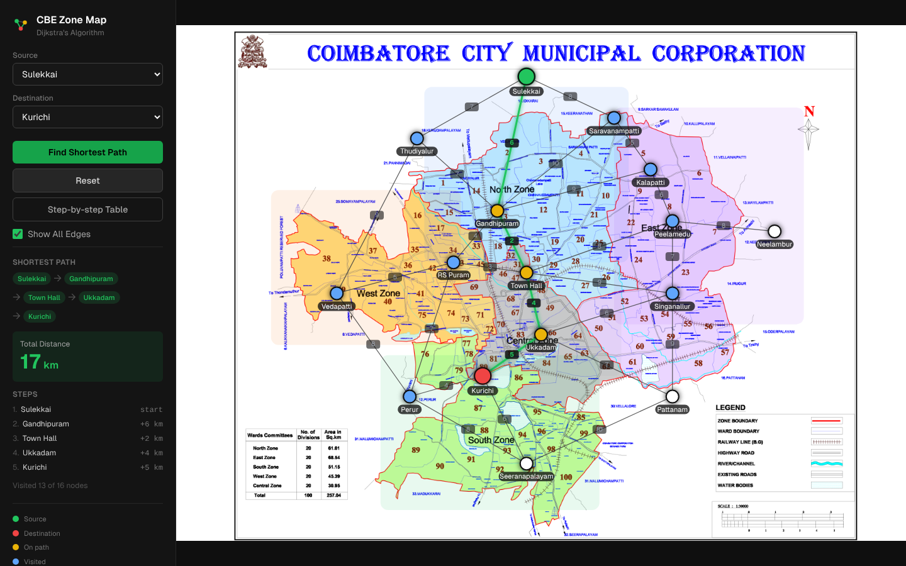

# CBE Zone Map: Dijkstra Shortest-Path Visualizer with a C++17 Verification Framework

[](https://github.com/Athelesh-7G/CBE-ZONE-NODES/actions/workflows/ci.yml)
[](LICENSE)
[](https://cbe-zone-nodes.vercel.app)


An interactive Dijkstra visualizer on the Coimbatore City Municipal Corporation zone map,
plus an independent **C++17 verification toolchain** that checks the TypeScript
implementation from the outside: three reference solvers, differential and property-based
testing, mutation testing, automatic test-case reduction, sanitizer builds and a fuzz target.



**[Live demo](https://cbe-zone-nodes.vercel.app)** · **[Verification toolchain](verification/README.md)**

## Highlights

- **Visualizer:** pick any two of 16 real Coimbatore localities. Nodes light up in the order
  Dijkstra settles them, the shortest route draws itself edge by edge, and every relaxation
  step lands in a trace table.
- **Independent verification:** `lib/dijkstra.ts` is checked against Dijkstra
  (`std::priority_queue`), Bellman-Ford and Floyd-Warshall written in C++17, which share no
  code with it or with each other.
- **Testing techniques from compiler and systems verification:** differential testing,
  seeded property-based testing, mutation testing, delta-debugging (ddmin) test reduction,
  a regression corpus, ASan + UBSan, and a libFuzzer target.
- **Measured, not assumed:** a C++ benchmark disproved my own performance claim about the
  priority queue, and I corrected the code comment and this README (see
  [Design note](#design-note-a-claim-the-benchmark-disproved)).
- **CI on every push:** lint, test and build, plus the C++ suite under both GCC and clang.

## What It Does

- **Node selection:** choose a source and destination from the 16 mapped localities; the map
  marks them green and red.
- **Animation sequence:** settled nodes turn blue one at a time in visit order, then the
  shortest path draws itself in green from source to destination.
- **Step-by-step trace:** one row per settled node with its final distance and the tentative
  distance pushed to each neighbour; rows on the final path are highlighted.
- **Distance results:** the route as a chain of nodes, the total distance in km, and a
  per-leg breakdown.

## Algorithm

`lib/dijkstra.ts` implements Dijkstra's algorithm over an undirected, positively weighted
graph of 16 nodes and 28 edges: real Coimbatore localities and approximate road distances
between them (integer weights from 2 to 10). The frontier is a min-priority queue backed by
a sorted array with binary-search insertion, chosen for simplicity (insertion is O(n)
because of the array shift), and stale queue entries are skipped once a node is settled. At
16 nodes the queue cost is negligible either way.

The search stops as soon as the destination is settled, so `distances` for other nodes in a
result are not guaranteed final; `totalDistance` and `path` are. If the destination is
unreachable (or an id is unknown), the result has `found: false`, an empty `path` and
`totalDistance: 0`; unreachable nodes keep a distance of `Infinity`.

## Verification

Two independent layers, both run by `npm run test:all` and by CI.

### Layer 1: TypeScript suite (`npm test`)

Node's built-in test runner via `tsx` (`tests/dijkstra.test.ts`), **17 tests**. The
Bellman-Ford reference in `tests/reference/bellmanFord.ts` is test-only and shares no code
with `lib/dijkstra.ts`.

| Group | What it checks |
| --- | --- |
| Graph sanity | Exactly 16 nodes and 28 edges; unique ids; no duplicate edges or self-loops; positive weights; undirected; connected |
| Differential | Dijkstra distance equals Bellman-Ford for all 240 ordered (source, destination) pairs |
| Path validation | For all 240 pairs: starts at source, ends at destination, no repeated node, every hop is a real edge, edge weights sum to the reported distance |
| Edge cases | source == destination gives 0 and `[source]`; unknown ids give `found: false`; d(s,t) == d(t,s) |
| Properties | Triangle inequality over all 16³ triples; identical results across repeated runs |
| Stale entries | On a synthetic graph that queues a node twice, the node is settled once |
| Unreachable | On a synthetic disconnected graph: `found: false`, empty path, `Infinity` distance |

### Layer 2: C++17 toolchain (`npm run test:cpp`)

```text
  lib/dijkstra.ts (unchanged)                    verification/ (C++17)
        |  export graph + results (tsx)                  |
        +--------------------------------------> cbe_tests (own framework "tt")
        |  run seeded random graphs through TS           |
        +--------------------------------------> Dijkstra (heap) / Bellman-Ford / Floyd-Warshall
                                                 differential engine, 8 property tests,
                                                 9 graph shapes, mutation suite, reducer,
                                                 corpus replay, sanitizers, fuzz target
```

| Technique | What it does here |
| --- | --- |
| **Independent oracles** | Dijkstra (lazy-deletion `priority_queue`), Bellman-Ford (with a negative-cycle pass) and Floyd-Warshall (next-hop matrix) run on the same graph; distances and reachability are compared and every returned path is validated |
| **Property-based testing** | 8 properties over seeded random graphs of 2 to 200 nodes in 9 shapes (random, sparse, disconnected, chain, cycle, star, complete, grid, layered), including ties, zero weights, parallel edges and weights up to 1e9 |
| **Optimality certificate** | Proves a distance vector is the shortest-path vector without comparing against any other solver (feasible on every edge, tight into every node) |
| **Mutation testing** | 12 injected bugs (`<=` vs `<`, dropped neighbour, wrong heap order, int32 overflow, and so on); the suite must fail on each |
| **Test-case reduction** | Delta debugging (ddmin) shrinks a failing graph; one real run reduced 25 nodes / 300 edges to 4 nodes / 4 edges |
| **Regression corpus** | 10 reduced reproducers, replayed on every run |
| **Sanitizers and fuzzing** | ASan + UBSan preset; a libFuzzer target that parses arbitrary bytes as a graph and runs the differential engine |
| **TypeScript bridge** | The real graph (all 240 ordered pairs) and 150 generated graphs (4,500 queries) go through the unmodified `lib/dijkstra.ts` |

### Results

Observed on the machines listed in [`verification/README.md`](verification/README.md#results-from-real-runs)
(Apple clang 21 on macOS; GCC 14.4 and clang 19 on Linux in Docker).

| Check | Result |
| --- | --- |
| TypeScript suite | 17 / 17 pass |
| C++ suite | 45 tests in 12 suites, all pass: identical under GCC 14.4, clang, and ASan + UBSan |
| Real graph, all 240 ordered pairs | All three solvers agree, and `lib/dijkstra.ts` matches |
| Random graphs through TypeScript | 150 graphs / 4,500 queries, 0 mismatches |
| Generated cases in property and unit-under-test suites | 2,100 |
| Mutation testing | 12 of 12 injected bugs killed |
| libFuzzer (C++ parser and solvers) | 51,961 executions in 46 s, no failure |

### Limits

Please read these before trusting any number above.

- This verifies **a shortest-path implementation**. It is not a compiler test suite.
- It found **no bugs** in `lib/dijkstra.ts`: every check passed. Its only failures are the
  deliberate ones from injected mutants.
- The **mutation score is relative to the 12 mutants I wrote**; 12/12 does not mean the suite
  finds every bug. Two of the twelve (`stale-check-off-by-one`, `no-stale-skip`) change no
  output, so only a work-counting test (`Uut.ExpandsEachNodeAtMostOnce`) catches them;
  without it both survive.
- The 240-pair check is exhaustive **only for the one fixed 16-node graph**; random graphs
  sample a large space but are not exhaustive.
- The oracles are mine. Three independent solvers reduce the chance of a shared mistake;
  they do not remove it.
- The **fuzz target fuzzes the C++ parser and solvers, not the TypeScript**. TypeScript is
  exercised through the seeded bridge only.
- Full list of limits: [`verification/README.md`](verification/README.md#limits).

### Design note: a claim the benchmark disproved

The shipped queue is a sorted array. I first assumed its constant factor would beat a binary
heap at this size. A C++ benchmark (`cbe_bench`) showed otherwise: the heap was as fast as or
faster at every size measured, and far faster on large graphs (100,000 nodes: about 14 ms
vs 3.7 s). At the real 16-node graph the two are a tie (under a microsecond either way), so
the sorted array is fine here, but a heap is the right choice for anything larger. I
corrected the comment in `lib/dijkstra.ts` and this README. V8's array operations are not
C++'s `vector`, so treat the C++ numbers as evidence about the algorithm, not a TypeScript
timing guarantee. Details: [`verification/README.md`](verification/README.md#benchmark-sorted-array-vs-binary-heap-c-this-machine).

## Quickstart

```bash
npm ci
npm run dev        # http://localhost:3000
npm run build      # production build
npm test           # TypeScript suite (17 tests)
npm run test:cpp   # C++ toolchain (needs CMake and a C++17 compiler)
npm run test:all   # both
```

The C++ toolchain uses the standard library only (no JSON or test-library dependencies);
data moves between TypeScript and C++ as plain text files. Presets for sanitizer and fuzz
builds are in `verification/CMakePresets.json`.

## CI

`.github/workflows/ci.yml` runs on every push and pull request:

| Job | What it runs |
| --- | --- |
| `check` | `npm ci`, lint, TypeScript tests, production build |
| `cpp (gcc)`, `cpp (clang)` | The C++ suite (differential, property and mutation tests and the TypeScript bridge) plus a benchmark smoke test, with JUnit XML uploaded as an artifact |
| `cpp-sanitizers` | The suite under ASan + UBSan (clang). Marked `continue-on-error` because sanitizer runs can fail on some runner kernel and clang combinations, so a green check does not by itself prove this job passed; read its log |

## Project Structure

```text
app/            Next.js App Router UI (SVG overlay on the zone map)
lib/            dijkstra.ts and graph.ts (nodes, edges, coordinates)
tests/          TypeScript suite, Bellman-Ford reference, C++ bridge scripts
verification/   C++17 toolchain: solvers, differential engine, generators, mutation,
                reducer, corpus, fuzz target, benchmark, own test framework (tt)
.github/        CI workflow
public/         zone_map.png (rendered from Zone Map.pdf)
demo.png       README screenshot
```

## Tech Stack

| Layer | Choice |
| --- | --- |
| UI | Next.js 14 (App Router), TypeScript, Tailwind CSS, SVG overlay on the zone map |
| Verification | C++17, CMake presets, own test framework (`tt`), libFuzzer |
| Quality gates | GitHub Actions (GCC and clang), ASan + UBSan, ESLint |
| Hosting | Vercel |

## Nodes Covered

| | |
| --- | --- |
| Sulekkai | Town Hall |
| Thudiyalur | Singanallur |
| Saravanampatti | Vedapatti |
| Kalapatti | Ukkadam |
| Gandhipuram | Kurichi |
| Peelamedu | Perur |
| Neelambur | Pattanam |
| RS Puram | Seeranapalayam |

## Notes

- Node coordinates are stored as fractions (0 to 1) of the map image and scaled to its
  rendered size at draw time, so the overlay stays aligned under `object-fit: contain` at any
  window size.
- The zone tint rectangles are rough regions for orientation, not real ward boundaries.
- Started as an AI/ML course project; the verification toolchain was added afterwards.

## License

MIT. See [LICENSE](LICENSE).
